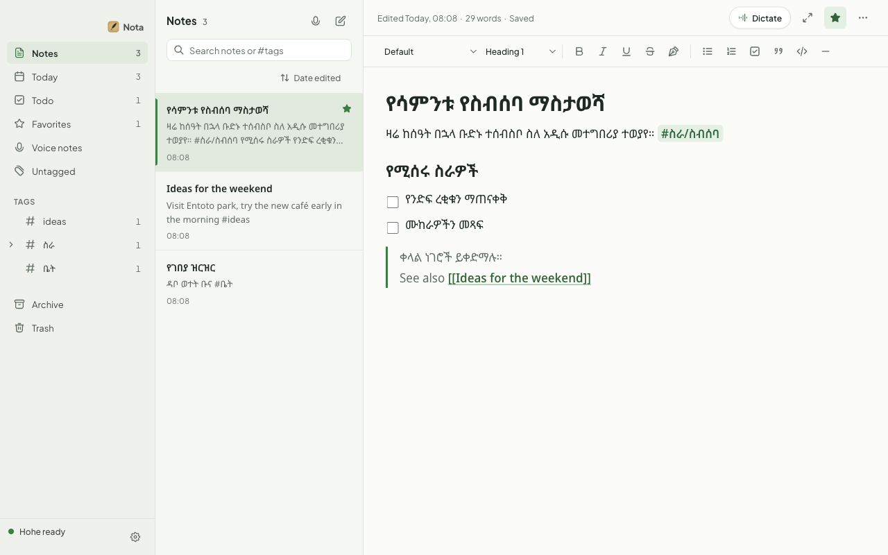
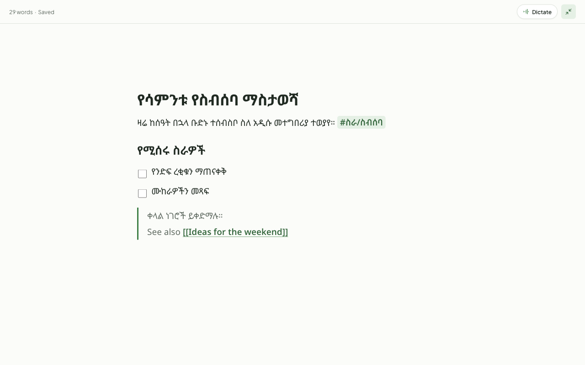
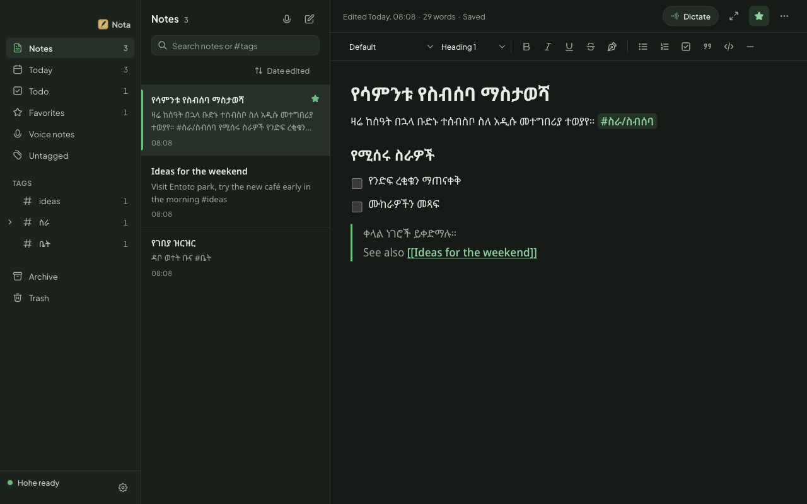
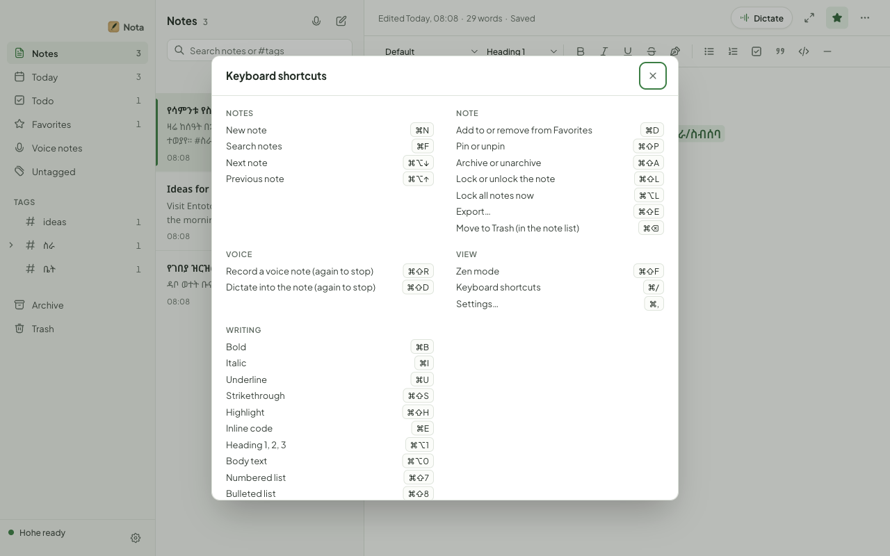
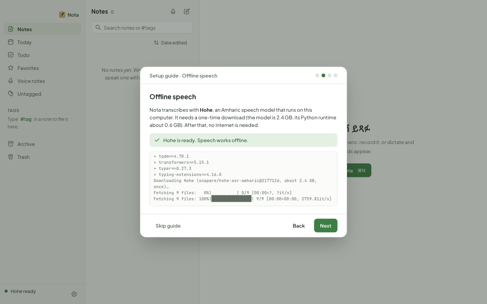

<p align="center">
  
</p>

<h1 align="center">Nota · ማስታወሻ</h1>

<p align="center">
  Offline Amharic notes you can write or speak.<br>
  Markdown editing, voice notes and live dictation, transcribed on your own computer.
</p>

<p align="center">
  
</p>

Nota is a desktop note-taking app for macOS, Windows and Linux, in the spirit of
[Bear](https://bear.app). Write in Amharic or English with Markdown shortcuts,
organise with `#tags` and `[[links]]`, and when typing is slow, speak: record
a voice note, or dictate and watch the words appear after each pause. Speech
is transcribed by **Hohe**, an Amharic speech model that runs locally. After a
one-time setup, nothing needs the internet, and nothing leaves your computer.

## Features

- **Markdown as you type.** `# ` heading, `- ` list, `[ ] ` checklist, `> `
  quote, `**bold**`, `==highlight==`, ` ``` ` code and more turn into
  formatting as you write, in a rich-text editor ([Tiptap](https://tiptap.dev)).
- **15 fonts, Amharic first.** Inter, Roboto, Lora, Merriweather, Playfair
  Display, JetBrains Mono and others, plus Noto Sans Ethiopic, Noto Serif
  Ethiopic and Abyssinica SIL. Every Latin font falls back to a Ge'ez face, so
  Amharic never shows as boxes. All fonts ship with the app.
- **Organise like Bear.** Sections for Notes, Today, Todo, Favorites, Voice
  notes and Untagged; nested tags (`#work/meetings`); pinning; an Archive; the
  Trash; links between notes with backlinks; search in Amharic or English
  (with `#tag` filters); sort by date edited, date created or title.
- **Voice notes.** Record, and the transcript becomes a new note you can edit.
  Play the recording back any time, or transcribe it again.
- **Live dictation.** Speak into the open note; the text appears at the cursor
  after each pause while you keep talking.
- **Zen mode** (⌘⇧F): only the note on screen, for distraction-free writing
  or dictation, with the current line kept in the middle.
- **Locked notes.** Encrypt a note (and its recording) with a password: AES-256-GCM,
  key derived with scrypt and held in memory only while unlocked.
- **Export** a note as Markdown, a web page or plain text.
- **Keyboard first.** A full menu bar and a shortcuts panel (⌘/).
- **Light and dark**, in green and gold: Ethiopia's highland fields and the
  Meskel daisy.

| Zen mode | Dark | Shortcuts |
|---|---|---|
|  |  |  |

## Download

Get the latest build from [Releases](https://github.com/rabira-hierpa/Nota/releases):

| System | File |
|---|---|
| macOS, Apple silicon (M1 and later) | `Nota-<version>-mac-arm64.dmg` |
| macOS, Intel | `Nota-<version>-mac-x64.dmg` |
| Windows, x64 | `Nota-<version>-win-x64-setup.exe` (or the portable `.zip`) |
| Windows, ARM64 | `Nota-<version>-win-arm64-setup.exe` (or `.zip`) |
| Linux, x86-64 | `Nota-<version>-linux-x86_64.AppImage` (or `.tar.gz`) |
| Linux, ARM64 | `Nota-<version>-linux-arm64.AppImage` (or `.tar.gz`) |

**macOS:** the app is not notarised by Apple yet, so the first launch is
blocked. Drag Nota to Applications, then either right-click it and choose
**Open**, or run:

```bash
xattr -dr com.apple.quarantine /Applications/Nota.app
```

**Windows:** the installer is not signed yet, so SmartScreen warns on first
run: choose **More info**, then **Run anyway**.

**Linux:** make the AppImage executable and run it:

```bash
chmod +x Nota-*.AppImage && ./Nota-*.AppImage
```

If it closes at once on Ubuntu 24.04 or later (a sandbox restriction on
AppImages), start it with `--no-sandbox`.

On first launch, Nota opens its **setup guide**, which sets up offline speech
for you (next section). Writing works right away without it.

## Set up offline speech (Hohe)

Nota transcribes with [Hohe](https://huggingface.co/snapwre/hohe-asr-amharic),
an Amharic speech model. Setting it up downloads, once:

- the model: 2.4 GB, into the Hugging Face cache (`~/.cache/huggingface`);
- a private Python runtime for it: about 0.6 GB, in Nota's data folder.

After that, transcription and dictation work with no internet connection.

**You need** Python 3.10–3.13, or [uv](https://docs.astral.sh/uv/) (which
fetches a Python by itself), plus about 4 GB of free disk space and 3 GB of
free memory while transcribing.

| System | Install Python if you don't have it |
|---|---|
| macOS | `brew install python@3.12`, or the installer from [python.org](https://www.python.org/downloads/) |
| Windows | The installer from [python.org](https://www.python.org/downloads/) (tick *Add python.exe to PATH*) |
| Ubuntu / Debian | `sudo apt install python3 python3-venv` |
| macOS, Linux (uv) | `curl -LsSf https://astral.sh/uv/install.sh \| sh` |
| Windows (uv) | `powershell -c "irm https://astral.sh/uv/install.ps1 \| iex"` |

### From the app

Open the setup guide (it opens on first launch, and any time from
**Settings → Setup guide**), go to **Offline speech** and press
**Set up Hohe**. Progress shows as it runs, and the status turns to
**Hohe ready** when it is done.

<p align="center">
  
</p>

### From a terminal

In a clone of this repository:

```bash
npm run setup:hohe
```

This runs [`scripts/setup-amharic-model.sh`](scripts/setup-amharic-model.sh), or
[`setup-amharic-model.ps1`](scripts/setup-amharic-model.ps1) on Windows (both
also ship inside the app, in its resources folder). It:

1. creates Nota's Python runtime in `<data folder>/python` (with `uv` if you
   have it, or the first Python 3.10–3.13 it finds), and installs the pinned
   packages in [`scripts/speech-requirements.txt`](scripts/speech-requirements.txt)
   (PyTorch, transformers, huggingface_hub, NumPy; CPU-only PyTorch on Linux);
2. downloads Hohe at a pinned revision into `<data folder>/models` (linked to
   the Hugging Face cache on macOS and Linux, copied on Windows), using
   [`scripts/setup_models.py`](scripts/setup_models.py);
3. checks that the model loads, so problems show now rather than on your first
   recording.

Running it again is safe; it reuses what is already there. There's no need to
restart Nota: it notices the model within a few seconds.

| | Data folder |
|---|---|
| macOS | `~/Library/Application Support/Nota` |
| Windows | `%APPDATA%\Nota` |
| Linux | `~/.config/Nota` |

**Optional: BuzzASR.** A second model, a Whisper large-v3 fine-tune (3.1 GB),
slower and less accurate in our tests. `npm run setup:amharic-model -- buzzasr`
adds it; pick it in **Settings → Speech model**.

**Using another Python.** If you already have a Python environment with the
packages, point Nota at it instead of building one:
`NOTA_PYTHON=/path/to/python npm run setup:hohe` (and set `NOTA_PYTHON` for the
app too). Nota also finds the runtime that [VoiceStudio](https://github.com/debpalash/VoiceStudio)
installs on macOS, if you have it.

**Trouble?**

- *"Nota needs Python 3.10–3.13"*: install one (table above), then run the
  setup again.
- *Hohe shows "not set up" after the setup finished*: check that
  `<data folder>/models/hohe-asr-amharic-217712d/model.safetensors` exists.
- *Transcription fails on Linux*: run the setup from a terminal to see the
  full output.

## Run from source

```bash
git clone https://github.com/rabira-hierpa/Nota.git
cd Nota
npm install
npm run dev
```

`npm run dev` starts the Next.js renderer, rebuilds the Electron main process
on change, and opens the app. On first run the setup guide walks you through
offline speech, the microphone, and Markdown; set up Hohe there, or with
`npm run setup:hohe` before starting. Requires Node.js 22 or later.

To run the production build: `npm run build && npm start`.

## Using Nota

| Do this | How |
|---|---|
| New note | ⌘N. Its first line is the title. |
| Format | Type Markdown (`# `, `- `, `[ ] `, `> `, `**bold**`, `==mark==`, `` `code` ``, `---`), or use the toolbar |
| Tag a note | Type `#tag` or `#parent/child` anywhere in it |
| Link notes | Type `[[Another note's title]]`; ⌘-click it to open (or create) that note |
| Record a voice note | The microphone above the note list, or ⌘⇧R; again to stop |
| Dictate | **Dictate** in the note, or ⌘⇧D; text appears after each pause |
| Distraction-free | ⌘⇧F for Zen mode; Escape to leave |
| Lock a note | Note menu (•••) → **Lock note**; ⌘⌥L locks all again |
| Export | Note menu → Markdown, Web page or Plain text |
| Every shortcut | ⌘/ (Ctrl instead of ⌘ on Windows and Linux) |

Locked notes use one app password. **There is no recovery**: without the
password, nobody can open a locked note, including you.

## Privacy and data

Everything lives in Nota's data folder: one JSON file per note, plus a WAV for
spoken notes. Nota makes no network requests while you use it: fonts ship with
the app, and transcription runs on your machine with Hugging Face's offline
mode switched on. The only downloads are the ones the speech setup makes, once.

## The models

| | **Hohe** (default) | **BuzzASR** (optional) |
|---|---|---|
| Model | [snapwre/hohe-asr-amharic](https://huggingface.co/snapwre/hohe-asr-amharic) | [BuzzASR/amharic](https://huggingface.co/BuzzASR/amharic) |
| Kind | wav2vec2-BERT 600M + CTC: one pass over the audio | Whisper large-v3 (1.55B) fine-tune: writes text token by token |
| Reported FLEURS Amharic error | 6.3% characters, 17.9% words | ~12% characters, ~34% words |
| A 19 s clip on an M-series GPU | 0.7 s | 4–7 s |
| Memory while loaded | about 2.5 GB | 4.4 GB |
| Licence | CC BY 4.0 | MIT |
| Weak spots (per its card) | spontaneous conversation, spells numbers out, no punctuation | can invent text for silence, slower |

Stock Whisper (including large-v3) learned almost no Amharic: about **193%
character error** on FLEURS Amharic. Nota decodes both models itself
([`electron/python/amharic_transcriber.py`](electron/python/amharic_transcriber.py)).
On Apple silicon it uses the GPU; elsewhere the CPU. Long recordings are split
at pauses into chunks under 30 s, and the model's helper process exits after
five idle minutes to free memory.

## Configuration

Optional, for development (environment variables, or a `.env` file; see
`.env.example`):

| Variable | Purpose |
|---|---|
| `NOTA_PYTHON` | Python that runs the model (default: Nota's own runtime) |
| `HOHE_MODEL_DIR`, `BUZZASR_MODEL_DIR` | Model folders (default: in the data folder) |
| `STT_ENGINE=voicestudio` | Use VoiceStudio's speech API instead of the local models |
| `VOICESTUDIO_URL`, `OMNIVOICE_API_KEY` | Where VoiceStudio is, and its key if remote |

## Build a release

```bash
npm run package:mac     # DMG and zip, Apple silicon and Intel, in release/
npm run package:win     # installer and zip, x64 and ARM64
npm run package:linux   # AppImage and tar.gz, x86-64 and ARM64
```

Mac builds are ad-hoc signed (not notarised); Windows builds are unsigned.
All three can be built on a Mac.

## Development

```bash
npm run typecheck && npm run lint && npm test   # types, lint, unit tests
npm run test:e2e                                # builds, then drives the app
```

Electron main process (`electron/`), a Next.js static export as the renderer
(`src/`), and a Zod-validated IPC contract between them (`shared/`). See
[CLAUDE.md](CLAUDE.md) for the architecture and [`.claude/rules/`](.claude/rules)
for the conventions.

## Credits

- **Hohe ASR** (`snapwre/hohe-asr-amharic`) by Chapi and the Dataset.ET
  contributors, licensed [CC BY 4.0](https://creativecommons.org/licenses/by/4.0/),
  fine-tuned from `badrex/Ethio-ASR-multilingual-600M` (CC BY 4.0).
- **BuzzASR/amharic**, MIT licensed.
- Neither model is bundled; the setup downloads them from Hugging Face.
- Fonts from Google Fonts under the SIL Open Font License; icons from
  [Untitled UI](https://www.untitledui.com/icons); editor by [Tiptap](https://tiptap.dev).

## License

Nota is released under the [MIT License](LICENSE). The speech models it can
download keep their own licences (above).
